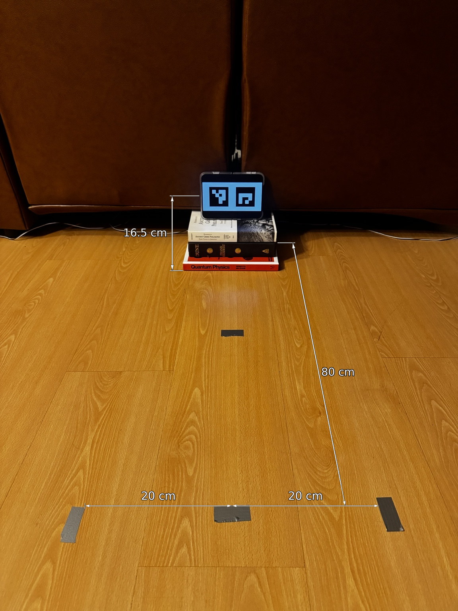
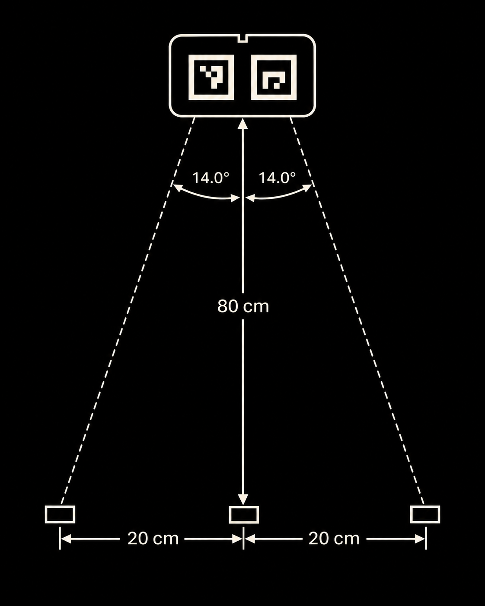

# ArUco Marker Detection - Initial Bench Experiment

**Status:** Physical setup complete | Software validation pending
**Contributors:** Nicholas - physical setup and measurements; David - software and detection validation

## 1. Objective

The objective of this experiment is to establish a repeatable ArUco marker detection setup and verify whether the vision software can correctly identify the printed markers in captured images.

This experiment is the first step toward estimating the camera's position and signed lateral displacement relative to a runway centerline. 

## 2. Physical Setup

The three ArUco markers are displayed on the iPhone Duo, which is supported by a stack of books. Three tape reference markers are placed in front of the device: one centered and two offset to either side.

### Dimensioned setup

### Top-down layout

### Measured dimensions

| Parameter | Measurement | Reference |
|---|---|---|
| Screen midpoint height | 16.5 cm | Floor to screen midpoint |
| Center reference distance | 80.0 cm | Screen plane to facing edge of rear-center tape marker |
| Left reference spacing | 20.0 cm | Center midpoint to inside edge of left tape marker |
| Right reference spacing | 20.0 cm | Center midpoint to inside edge of right tape marker |

**Measurement notes:** Standard steel tape measure (Metric, 1mm resolution) 

## 3. Hardware

| Component | Configuration |
|---|---|
| Marker display | iPhone Duo |
| Camera | iPhone 15 Pro Main Camera - 24mm f1.78 |
| Processing computer | Surface Studio Laptop 2 |
| Marker dictionary | DICT_4X4_50 |
| Marker IDs | 0 and 1 | 
| Camera resolution | 2160 x 3840 |

## 4. Methodology

### 4.1 Physical Setup and Data Collection
1. iPhone Duo was propped up on books, distance from floor to display midpoint measured.
2. Measured a perpendicular distance 80 cm from the center of the display, and placed duct tape reference. Measured and placed offset references 20 cm from middle reference. 
3. Displayed the ArUco markers (0 & 1) on Duo display
4. Placed and secured the camera on the reference, recorded video for 5 seconds. 
5. Repeated step 4 with 7 videos: 
- `Center`
- `Left`
- `Right`
- `Left_Angled`
- `Right_Angled`
- `QR_Test`
- `No_Target`
### 4.2 Software Processing and Validation
6. Execute the ArUco detection program.
7. Save the returned marker IDs and detected corner coordinates.
8. Save an annotated output generated from the same input frame.
9. Compare expected and observed detections.
10. Record failures, test configuration and software revision.

## 5. Software

The ArUco marker detection program was implemented in C++17 using OpenCV 4.12.0 on Windows x64. The program processes prerecorded .MOV video files using cv::VideoCapture and identifies markers with OpenCV's cv::aruco::ArucoDetector.

Detector configuration:

Programming language: C++17
Computer vision library: OpenCV 4.12.0
ArUco dictionary: DICT_4X4_50
Target marker IDs: 0 and 1
Input: Prerecorded .MOV video
Processing: Every successfully decoded frame
Output: Total frame count and frame counts classified as BOTH, ONLY_0, ONLY_1, or NEITHER

**Source code:** arcuro_detector.cpp 

**Run command:** build\Release\aruco_detector.exe videos\<video_file>.MOV

**Software revision:** feature/aruco-detection branch, initial C++ ArUco detector implementation.

## 6. Experimental Results

### Input image

Add the raw input frame to the results folder.

### Detection output

The ArUco Detector successfully identifies both target markers for all 393 frames of the center test recording 

| Metric | Result |
|---|---|
| Expected marker IDs | 0,1 |
| Detected marker IDs | 0,1 |
| Total frames processed | 393 |
| Frames with both markers detected |  393 (100%) |
| Missed markers | None |
| Unexpected detections | Not evaluated |
| Test outcome | PASS |

## 7. Limitations

- Marker identification is not equivalent to calibrated camera pose estimation.
- Camera intrinsics and distortion must be determined for metric pose estimation.
- Dimensions and physical reference points must be verified before geometric calculations.
- Performance under different lighting, range and camera yaw is not yet established.

## 8. Next Steps

- Complete the first documented detection run.
- Save paired raw and annotated images.
- Measure and define all required marker coordinates.
- Calibrate the camera.
- Extend the experiment to camera pose and signed lateral offset estimation.
