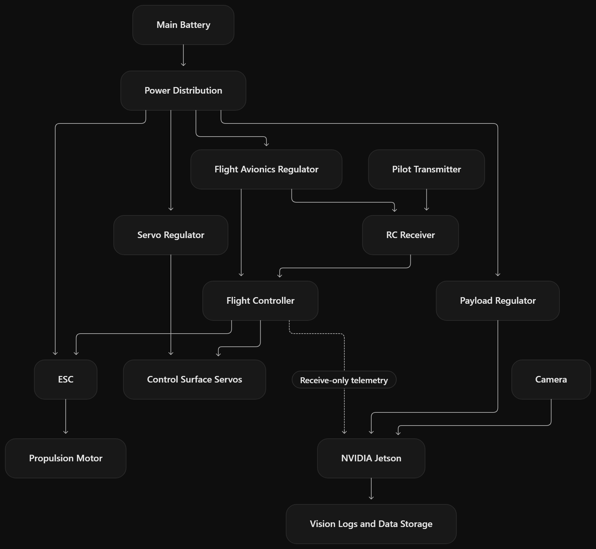

# Avionics & Vision Payload Design

## 1. System Architecture 

*Figure 1. Preliminary Avionics and Vision Payload Architecture.* The system uses a shared battery with separate power for propulsion, flight-control avionics, servos, and the payload. The Jetson receives telemetry and processes camera data independently of the flight control system.
